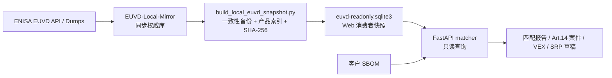
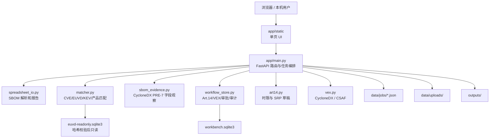

# EUVD Dependency Workbench v2.3.1 开发交接说明

> 历史快照：本文保留 v2.3.1 当时的本机路径、镜像和测试记录，仅用于追溯。
> 当前候选为 `2.4.0-rc.1`，以 `RELEASE_CANDIDATE_2.4.0-rc.1.md` 为准；本文
> 不能证明当前版本、公开发布、客户交付或符合性。

文档日期：2026-08-04  
交接对象：后续维护、测试和扩展本项目的人类程序员  
当前版本：`v2.3.1` Docker 本机候选  
当前状态：可在本机受控使用；不是客户发布版、CRA 符合性结论或 SRP 正式提交系统

## 1. 先读结论

本系统是一个本地运行的 SBOM 漏洞工作台：导入客户 SBOM，优先使用本地 EUVD
镜像完成 CVE→EUVD、漏洞详情和 EU/CISA KEV 公开信号匹配，再由人类对产品适用性、
实际利用证据和 CRA Article 14 报告义务进行判断。系统也能保存案件、VEX、双人复核、
awareness 时间和 SRP 分阶段草稿，但不会自动作出法律结论，也不会自动向 ENISA SRP
提交。

当前实现由两个彼此分离的项目组成：

1. Web 工作台负责导入、匹配、报告和 Art.14 工作流；
2. 独立 EUVD Mirror 负责官方数据的全量和增量同步。

这两个目录目前都不是 Git 仓库。接手后应优先建立版本控制、忽略规则、备份和版本化
发布流程；在此之前不要移动目录、合并数据库或删除历史证据。

### 1.1 术语

| 缩写 | 含义 |
| --- | --- |
| SBOM | Software Bill of Materials，软件物料清单 |
| EUVD | European Vulnerability Database，欧洲漏洞数据库 |
| KEV | Known Exploited Vulnerabilities，已知被利用漏洞清单 |
| SRP | Single Reporting Platform，CRA 单一报告平台 |
| VEX | Vulnerability Exploitability eXchange，漏洞可利用性状态交换 |
| PURL / CPE | Package URL / Common Platform Enumeration，组件标识格式 |
| PRE-7 | 本项目冻结的 prEN 40000-1-3 草案中的 SBOM 评估过程标识 |
| PRO-03B | 本项目客户 SBOM/HBOM 填写模板的内部文件编号 |
| LKG | Last Known Good，最近一次已验证可用数据 |
| WAL | SQLite Write-Ahead Log，预写式日志 |
| CSP | Content Security Policy，浏览器内容安全策略 |

## 2. 项目地址与职责边界

### 2.1 Web 工作台

```text
/Users/mac/Documents/AI-Cybersecurity/euvd-sbom-matcher
```

职责：

- Web UI 和 FastAPI API；
- 客户 SBOM 导入、字段映射和漏洞匹配；
- Excel 报告、VEX 和 SRP 草稿导出；
- 项目历史、Art.14 案件、证据、复核和提交回执；
- 读取经过哈希校验的 EUVD 消费者快照；
- 受控的 Syft 源代码/镜像 SBOM 生成入口。

### 2.2 正式 EUVD 同步项目

```text
/Users/mac/EUVD-Local-Mirror
```

正式同步权威数据库：

```text
/Users/mac/EUVD-Local-Mirror/data/euvd-mirror.sqlite3
```

职责：

- 首次 EUVD 全量下载；
- 按 `fromUpdatedDate` / `toUpdatedDate` 做增量同步；
- 使用重叠窗口和 EUVD ID 幂等 upsert；
- 同步 CVE↔EUVD mapping 与 EU/CISA KEV 参考数据；
- 保存同步状态、高水位、数据版本、日志和批量 CVE 匹配结果。

### 2.3 Web 使用的只读消费者快照

```text
/Users/mac/Documents/AI-Cybersecurity/euvd-sbom-matcher/data/euvd-readonly.sqlite3
/Users/mac/Documents/AI-Cybersecurity/euvd-sbom-matcher/data/euvd-readonly.sqlite3.sha256
```

Web 工作台不得直接写正式镜像。正确链路是：



特别注意：网页中的“刷新数据源”接口在本地快照存在时只重新检查并登记快照状态，
不会联网同步正式 EUVD 镜像，也不会重建消费者快照。

正式 Mirror 的主要代码和数据结构：

| 路径/对象 | 用途 |
| --- | --- |
| `euvd_sync.py` | `MirrorStore`、API client、全量/增量和 reference-data 同步 |
| `sbom_match.py` | 独立的客户 CVE/SBOM 批量匹配 CLI |
| `compose.yaml` | `euvd-sync` 与 `sbom-match` 容器入口 |
| `scripts/run_large_sample.sh` | 重复窗口、幂等和旧年份更新样本测试 |
| `tests/test_sync.py` | 增量窗口、重试、upsert 和参考数据测试 |
| `tests/test_sbom_match.py` | 输入解析、状态、审计和公式注入防护测试 |
| `logs/` | 每次同步的 JSON 运行摘要 |
| `docs/` | 可行性、样本、参考表和批量匹配报告 |

正式数据库没有独立 migration 版本表；schema 由 `MirrorStore._initialize()` 以
`CREATE TABLE IF NOT EXISTS` 建立。主要表为 `vulnerabilities`、`data_source_versions`、
`cve_euvd_mapping`、`known_exploited`、`known_exploited_sources`、`sync_state`、
`sync_runs`、`sbom_lookup_runs` 和 `sbom_lookup_results`。修改 schema 前应先补正式迁移
机制和升级/降级测试。

## 3. 当前运行快照

以下状态是 2026-08-04 现场核验结果，不应被当成永久常量：

| 项目 | 当前值 |
| --- | --- |
| Web 版本 | `2.3.1` |
| 本机地址 | `http://127.0.0.1:8090` |
| 容器状态 | `healthy` |
| Docker 镜像 | `euvd-dependency-workbench:2.3.1` |
| 当前运行容器 Image ID | `sha256:47b22400cef9f9285dd58f6e87894e59c56f3de43c289fdba02d2fa54caadf65` |
| 当前本机 `2.3.1` tag | `sha256:1c1f2fc2aced901be0bbda25572a26124f79789f7350774466f2bfb122939944` |
| EUVD 查询模式 | `local-read-only-snapshot` |
| 网络回退 | `false` |
| 数据状态 | `local_degraded` |
| 快照生成时间 | `2026-08-04T02:47:13+00:00` |
| EUVD 数据截止 | `2026-07-28` |
| 漏洞记录 | `370,723` |
| CVE→EUVD 映射 | `353,633` |
| KEV 记录 | `1,660` |
| 产品索引 | `1,110,119` |
| Web 快照 SHA-256 | `14fae69e0fed4b7fcd1cd4131c0efb18fe63a32328c92356cefe24c477c16088` |
| 正式镜像逻辑快照 SHA-256 | `84d44a46769a30579f3088de0452311d46cf6bead8158562e1b0d664e4bc8ea7` |
| SQLite 完整性 | 正式镜像和 Web 快照均为 `ok` |
| 当前 Web 自动化 | `40/40 PASS` |

`local_degraded` 是 health 中“本地查询模式 + degraded 新鲜度”的组合状态；底层新鲜度
分类仍是 `fresh`、`stale`、`degraded` 或 `unavailable`。

运行容器与本机 tag 的 ID 不同，是因为本次隔离 Demo 验证重新执行了 BuildKit build，
但未替换正在服务的主容器。这再次说明本地 tag 是可变名称，不是发布身份；任何候选都
必须绑定实际运行容器的 immutable image ID、源码清单和构建证据。

当前磁盘占用约为：

| 目录/文件 | 大小 |
| --- | ---: |
| Web 项目总目录 | `1.8 GB` |
| Web `data/` | `1.0 GB` |
| Web EUVD 快照 | `996 MB` |
| Web `self-test/` | `339 MB` |
| Windows `runtime/` | `59 MB` |
| 正式 Mirror 项目总目录 | `1.6 GB` |
| 正式镜像主数据库 | `809 MB` |

数据状态为 `local_degraded` 的原因是当前出口访问 ENISA 时曾收到 HTTP 403，高水位未
推进。系统保留 last-known-good 数据并明确标记降级，没有把本地读取时间冒充官方刷新
时间。不要绕过 403；应修复合法访问条件或由负责人接受 LKG 使用边界。

## 4. 软件架构

### 4.1 技术栈

| 层 | 实现 |
| --- | --- |
| 后端 | Python、FastAPI `0.140.7`、Starlette `1.3.1`、Uvicorn `0.51.0` |
| 前端 | 原生 HTML/CSS/JavaScript 单页应用，无前端构建链 |
| 表格 | openpyxl `3.1.5` |
| HTTP | httpx `0.28.1` |
| 数据库 | SQLite + JSON 任务文件 |
| 容器 | Docker Compose、Chainguard Python 运行时 |
| SBOM 扫描器 | Syft `1.50.0`，摘要锁定的独立 Compose profile |
| 输入格式 | XLSX/XLSM、CSV/TSV、CycloneDX JSON |
| 输出格式 | XLSX、JSON、HTML、CycloneDX VEX、CSAF VEX |

### 4.2 运行时组件



系统目前是单进程、单机、本地可信用户模型。扫描任务通过 FastAPI
`BackgroundTasks` 在 API 进程内执行，没有独立消息队列或 worker。服务重启时，原来
处于 `queued` 或 `running` 的任务会被标记为失败，提示用户重新扫描，不会自动续跑。

### 4.3 数据持久化

Web 侧共有三类持久化：

1. `data/jobs/*.json`：扫描任务状态、紧凑匹配结果和报告路径；
2. `data/workbench.sqlite3`：产品/SBOM 快照身份、Art.14 工作流、审批和审计；
3. `data/euvd-readonly.sqlite3`：只读 EUVD 消费者快照。

`workbench.sqlite3` 使用 WAL，当前 schema migration 版本为 `2`。主要表：

| 表 | 用途 |
| --- | --- |
| `schema_migrations` | 数据库迁移版本 |
| `sbom_snapshots` | 项目、版本、build、客户、原文件哈希和 SBOM 格式 |
| `cases` | 产品级 Art.14 案件和状态机 |
| `evidence` | 利用证据及产品相关性 |
| `reviewers` | 本地 reviewer、角色、scrypt PIN hash |
| `approvals` | 技术/合规复核记录 |
| `submission_receipts` | 分阶段人工提交回执；同案件同阶段唯一 |
| `audit_events` | 事件、actor、JSON payload 和 payload SHA-256 |
| `vex_imports` | VEX 来源、文件哈希、警告和导入数量 |
| `feed_snapshots` | 数据源状态、版本、哈希、数量和错误说明 |

EUVD 消费者快照的主要表：

| 表 | 用途 |
| --- | --- |
| `vulnerabilities` | EUVD 原始记录 JSON |
| `cve_euvd_mapping` | 规范化 CVE↔EUVD 多对多映射 |
| `known_exploited` | 已知被利用条目 |
| `known_exploited_sources` | `cisa_kev`、`eukev_kev` 等来源 |
| `data_source_versions` | 参考数据版本、内容哈希和记录数 |
| `local_products` | Web 快照构建时生成的产品/厂商/版本索引 |
| `web_snapshot_metadata` | 快照来源、时间、计数、哈希和新鲜度 |
| `sync_state` / `sync_runs` | 从正式镜像继承的同步状态和运行记录 |
| `sbom_lookup_runs` / `sbom_lookup_results` | 独立 Mirror 工具的批量匹配审计 |

JSON 任务和 SQLite 工作流不是一个原子事务。涉及任务创建、报告生成和案件创建的重构
应增加失败恢复与一致性测试，不能假设两者永远同步。

另一个需要注意的边界是：当前快照脚本先复制整个正式 Mirror，再增加 Web 产品索引，
所以消费者快照也继承了 `sbom_lookup_runs` / `sbom_lookup_results`。Web 查询并不需要这
两张表。如果独立 Mirror 曾处理客户敏感输入，构建快照前必须检查这些表；后续应改成
数据表 allowlist 或在发布消费者快照前移除非必要批量匹配审计数据。

## 5. 已开发能力

### 5.1 SBOM 导入与模板

- 支持 `.xlsx`、`.xlsm`、`.csv`、`.tsv` 和 CycloneDX `.json`；
- 自动寻找表头、识别多工作表中的 SBOM sheet；
- 支持中英文表头和用户确认字段映射；
- 默认最多处理 2,000 个组件；
- 通用上传最大 20 MB，CycloneDX 最大 10 MB；
- 支持组件名、版本、厂商、PURL、CPE、CVE、EUVD ID、许可证等字段；
- 网页下载模板为 PRO-03B v1.4 内容兼容的清理派生版；
- 报告中保留“输入SBOM快照”，用于保真查看原始表格行。

静态模板文件：

```text
app/assets/客户SBOM导入模板_PRO-03B_v1.4兼容版.xlsx
```

模板生成器与闭环 Demo：

```text
scripts/generate_pro03b_sbom_template.mjs
scripts/demo_template_roundtrip.mjs
```

模板是空白客户填写模板。空白模板可以预览，但因为没有组件，不能直接创建匹配任务。
Demo 数据只由测试脚本另行填入，不应写回客户模板。

### 5.2 漏洞匹配

匹配优先级：

1. 输入 EUVD ID：直接查 EUVD；
2. 输入 CVE：通过本地 `cve_euvd_mapping` 精确映射；
3. 无 CVE/EUVD ID：按产品名、厂商和版本做候选匹配；
4. 使用 PURL/CPE 和 `config/product-aliases.csv` 辅助规范化；
5. 产品、厂商或版本无法可靠确认时保留“需复核”，不强行变成命中或无漏洞。

候选产品匹配使用 EUVD 名称和版本表达式，可靠性低于 CVE/EUVD 精确匹配。修改别名或
版本规则时必须增加回归样例，防止不同供应商同名产品误合并。

### 5.3 KEV 与积极利用信号

- 读取 ENISA 汇总的 EU/CISA KEV 参考数据；
- 命中时标记为公开“已知利用信号”；
- 未命中时只表示“当前快照未列入”，不得表述为“未被利用”；
- KEV 命中会触发产品级 Art.14 人工复核，不会自动产生 `reportable` 决定；
- 系统不把 EPSS 当作实际利用证据。

### 5.4 Excel 报告和工作台

报告目前包含概要、精确/候选匹配、需人工复核、Art.14 待评估、组件、输入 SBOM
快照、错误和说明等内容，并记录查询覆盖率、数据状态和来源哈希。

Web UI 提供：

- 看板；
- 项目历史；
- 组件目录；
- EUVD 漏洞目录；
- Art.14 案件；
- SBOM/VEX 导入。

### 5.5 CycloneDX 与 PRE-7 字段证据

CycloneDX 导入会保留：

- `specVersion`、`serialNumber`、BOM `version`；
- metadata、tools、作者和时间；
- 原始 components、嵌套组件、dependencies；
- PURL、CPE、`bom-ref` 和 hashes；
- 引用重复、未解析依赖和字段缺口警告。

`app/sbom_evidence.py` 只输出字段存在性和证据缺口观察，并固定：

```text
automatic_conformity_decision=false
```

它不能证明 SBOM 总体完整性，也不能自动给出 C/PC/NC。当前 XLSX/CSV 路径尚未把
Metadata sheet、依赖关系、来源证据和缺口字段规范化为 PRE-7 项目级证据；这些字段只
保留在原始文件和报告的输入快照中。

### 5.6 Art.14 案件工作流

案件可从匹配结果创建，也可手工创建。当前支持：

- 产品适用性：调查中、已受影响、已知不受影响、已修复；
- 产品级利用证据和风险/缓解说明；
- 人工确认制造商 awareness；
- 以 awareness 为起点计算 24h 和 72h 最迟期限；
- 以修正/缓解措施可用时间为起点计算 14 日最终报告期限；
- 技术复核和合规复核必须由两个不同 reviewer 完成；
- 新 build 或 SBOM hash 变化使既有开放结论失效并重开；
- 人工登记 SRP 各阶段提交时间和回执。

本地 reviewer PIN 只用于区分工作流账户和阻止同一账户完成两道审批。它不是企业登录、
SSO、现实身份核验、合格电子签名或组织授权证明。

### 5.7 VEX 与 SRP 草稿

- 导入 CycloneDX 1.7 VEX 与 CSAF 2.0；
- 导出单案件 CycloneDX/CSAF VEX；
- `known_not_affected` 缺少产品级理由时降级为 `under_investigation`；
- 生成 `early-warning`、`notification`、`final-report` 三阶段 SRP 草稿；
- 按字段矩阵检查缺失项；
- 导出 JSON、XLSX 和 HTML；
- 只保存人工提交回执，不调用任何 SRP API。

### 5.8 从源代码/镜像生成 SBOM

项目已有受控 Syft sidecar：

```text
scripts/generate_sbom.py
scripts/reconcile_self_sboms.py
```

它可对源码目录和 Docker archive 生成 CycloneDX/Syft JSON、输入 exact-set manifest、
scanner control 和 generation evidence。扫描容器默认：断网、只读输入、只读根文件系统、
非 root、无 Docker socket、`CapDrop=ALL`、`no-new-privileges`，并锁定 Syft 镜像摘要。

源码、Linux 镜像和 Windows portable 必须作为三个不同制品身份，不能把其中一个 SBOM
代替另外两个。Windows portable 目前仍为 `REVIEW`，原因见第 12 节。

## 6. 目录与模块地图

```text
euvd-sbom-matcher/
├── app/
│   ├── main.py                 FastAPI、路由、上传和任务编排
│   ├── matcher.py              EUVD/KEV/产品匹配和本地快照访问
│   ├── spreadsheet_io.py       SBOM 解析、字段映射、Excel 报告
│   ├── sbom_evidence.py        CycloneDX 字段证据观察
│   ├── workflow_store.py       SQLite schema、Art.14 案件和审批
│   ├── art14.py                截止时间、SRP readiness 和导出
│   ├── vex.py                  CycloneDX/CSAF VEX 导入导出
│   ├── launcher.py             Windows/宿主启动辅助
│   ├── assets/                 版本化客户 SBOM 模板
│   └── static/                 HTML/CSS/JavaScript 单页 UI
├── config/
│   └── product-aliases.csv     客户名称到 EUVD 名称/厂商的别名
├── data/
│   ├── euvd-readonly.sqlite3   Web EUVD 消费者快照
│   ├── *.sha256                快照外部期望哈希
│   ├── workbench.sqlite3       案件和工作流数据库
│   ├── euvd-cache.sqlite3      网络/旧查询缓存
│   ├── uploads/                原始上传和紧凑上传记录
│   └── jobs/                   扫描任务 JSON
├── outputs/                    Excel/VEX/SRP/Demo 输出
├── scripts/                    快照、扫描、对账、模板和 portable 脚本
├── tests/                      40 项 Python 单元/回归测试
├── self-test/                  历史 P0-P4 内部证据
├── runtime/                    Windows portable runtime，当前 REVIEW
├── docs/                       操作、设计、测试和本交接文件
├── Dockerfile
├── docker-compose.yml
├── requirements.txt
└── README.md
```

关键实现入口：

| 需求 | 先读文件 |
| --- | --- |
| 新增/修改 API | `app/main.py` |
| 修改匹配算法 | `app/matcher.py`、`tests/test_matcher.py` |
| 修改表格字段 | `app/spreadsheet_io.py`、`tests/test_pro03b_template.py` |
| 修改 PRE-7 证据 | `app/sbom_evidence.py`、`tests/test_sbom_evidence.py` |
| 修改案件状态机 | `app/workflow_store.py`、`tests/test_v22_workflow.py` |
| 修改 SRP 字段 | `app/art14.py`、`tests/test_v22_workflow.py` |
| 修改 VEX | `app/vex.py`、`tests/test_v22_workflow.py` |
| 更新 EUVD 消费者快照 | `scripts/build_local_euvd_snapshot.py` |
| 修改前端 | `app/static/index.html`、`app/static/app.js`、`app/static/styles.css` |

## 7. HTTP API

运行后可打开：

```text
http://127.0.0.1:8090/api/docs
http://127.0.0.1:8090/openapi.json
```

当前主要路由：

| 方法 | 路径 | 用途 |
| --- | --- | --- |
| GET | `/api/health` | 版本、快照哈希、新鲜度和运行状态 |
| GET | `/api/dashboard` | 看板汇总 |
| GET | `/api/projects` | 项目/任务历史 |
| GET | `/api/catalog/components` | 跨项目组件目录 |
| GET | `/api/catalog/vulnerabilities` | 跨项目漏洞目录 |
| GET | `/api/euvd/status` | EUVD 在线/本地状态 |
| GET | `/api/euvd/snapshots` | 数据源快照 |
| POST | `/api/euvd/snapshots/refresh` | 检查并登记本地快照；不是正式同步 |
| POST | `/api/uploads/preview` | 上传、解析和字段映射预览 |
| POST | `/api/jobs` | 创建后台匹配任务 |
| GET | `/api/jobs/{job_id}` | 轮询任务 |
| GET | `/api/jobs/{job_id}/report` | 下载 Excel 报告 |
| GET | `/api/template` | 下载版本化客户模板 |
| GET/POST | `/api/reviewers` | 本地 reviewer 管理 |
| GET/POST | `/api/art14/cases` | 案件列表/手工创建 |
| POST | `/api/art14/cases/from-finding` | 从匹配发现创建案件 |
| GET/PATCH | `/api/art14/cases/{case_id}` | 读取/更新案件 |
| POST | `/api/art14/cases/{case_id}/evidence` | 增加证据 |
| POST | `/api/art14/cases/{case_id}/awareness` | 人工确认 awareness |
| POST | `/api/art14/cases/{case_id}/review` | 技术/合规复核 |
| POST | `/api/art14/cases/{case_id}/submission` | 登记人工提交回执 |
| POST | `/api/vex/import` | 导入 VEX |
| GET | `/api/art14/cases/{case_id}/vex/{vex_format}` | 导出 VEX |
| GET | `/api/art14/cases/{case_id}/srp/{stage}` | 读取 SRP 草稿 |
| GET | `/api/art14/cases/{case_id}/srp/{stage}/export/{extension}` | 导出 SRP 草稿 |

当前 API 没有稳定的外部版本前缀，例如 `/api/v1`，也没有外部客户端兼容性承诺。修改
request/response schema 前，应先增加 API 版本策略和契约测试。

## 8. 本机启动、停止和诊断

Docker 是当前唯一建议使用的运行路径。

当前宿主开发至少需要 Docker Desktop/Engine + Compose v2。直接运行测试或脚本还需要
兼容的 Python 和 `requirements.txt` 中的依赖；模板生成与闭环 Demo 另外需要 Node.js。
正式 Mirror 自带 `.venv/` 和 `requirements.txt`。当前没有统一的开发环境 bootstrap
脚本或锁哈希文件，接手人不应把宿主临时环境当作可复现发布环境。

当前现场验证环境为 Python `3.13.12`、Node `24.14.0`、Docker Engine `29.4.1`、
Compose `5.1.3` 和 SQLite CLI `3.51.0`；容器 builder 使用 Python 3.14。版本号只是本次
现场基线，不表示其他版本自动受支持。

### 8.1 首次启动前备份

`app/main.py` 的 startup hook 会删除 `data/uploads/` 中修改时间超过 7 天的普通文件。
当前没有 dry-run 或禁用开关。因此第一次接手、重启旧实例或需要保留历史上传证据时，
必须先停止 matcher 并备份；不要先执行 `up`。

Web 侧一致性备份示例：

```bash
set -e
cd '/Users/mac/Documents/AI-Cybersecurity/euvd-sbom-matcher'
docker compose stop matcher
test -s data/workbench.sqlite3
test "$(sqlite3 data/workbench.sqlite3 "SELECT COUNT(*) FROM sqlite_master WHERE type='table' AND name IN ('sbom_snapshots','cases','audit_events','feed_snapshots');")" = "4"
handoff_run_id="$(date -u +%Y%m%dT%H%M%SZ)-$(uuidgen | tr '[:upper:]' '[:lower:]')"
handoff_backup_dir="$PWD/backups/handoff-$handoff_run_id"
test ! -e "$handoff_backup_dir"
mkdir "$handoff_backup_dir"
mkdir "$handoff_backup_dir/uploads" "$handoff_backup_dir/jobs" "$handoff_backup_dir/outputs"
sqlite3 data/workbench.sqlite3 ".backup '$handoff_backup_dir/workbench.sqlite3'"
rsync -a data/uploads/ "$handoff_backup_dir/uploads/"
rsync -a data/jobs/ "$handoff_backup_dir/jobs/"
rsync -a outputs/ "$handoff_backup_dir/outputs/"
cp -p data/euvd-readonly.sqlite3 data/euvd-readonly.sqlite3.sha256 "$handoff_backup_dir/"
sqlite3 "$handoff_backup_dir/workbench.sqlite3" 'PRAGMA integrity_check;'
shasum -a 256 "$handoff_backup_dir/workbench.sqlite3" \
  "$handoff_backup_dir/euvd-readonly.sqlite3" \
  "$handoff_backup_dir/euvd-readonly.sqlite3.sha256" \
  > "$handoff_backup_dir/SHA256SUMS"
(cd "$handoff_backup_dir" && find uploads jobs outputs -type f -print | LC_ALL=C sort > ARTIFACT_FILELIST.txt)
(cd "$handoff_backup_dir" && find uploads jobs outputs -type f -exec shasum -a 256 {} \; > ARTIFACT_SHA256SUMS)
```

正式 Mirror 侧必须在确认没有同步写进程后用 SQLite backup，而不是只复制 WAL 主文件：

```bash
set -e
cd /Users/mac/EUVD-Local-Mirror
test -s data/euvd-mirror.sqlite3
test "$(sqlite3 data/euvd-mirror.sqlite3 "SELECT COUNT(*) FROM sqlite_master WHERE type='table' AND name IN ('vulnerabilities','data_source_versions','cve_euvd_mapping','known_exploited','known_exploited_sources','sync_state','sync_runs','sbom_lookup_runs','sbom_lookup_results');")" = "9"
handoff_run_id="${handoff_run_id:-$(date -u +%Y%m%dT%H%M%SZ)-$(uuidgen | tr '[:upper:]' '[:lower:]')}"
mirror_backup_dir="$PWD/backups/handoff-$handoff_run_id"
test ! -e "$mirror_backup_dir"
mkdir "$mirror_backup_dir"
sqlite3 data/euvd-mirror.sqlite3 ".backup '$mirror_backup_dir/euvd-mirror.sqlite3'"
sqlite3 "$mirror_backup_dir/euvd-mirror.sqlite3" 'PRAGMA integrity_check;'
shasum -a 256 "$mirror_backup_dir/euvd-mirror.sqlite3" > "$mirror_backup_dir/SHA256SUMS"
```

如果打开了新的 shell，先重新设置唯一 `handoff_run_id`。如果这些文件包含客户数据，
备份目录也必须按客户证据保护，不能提交 Git 或复制到未经批准的云端。上述命令只是当前
本机恢复点，不替代组织级备份/保留制度。

### 8.2 启动和停止

```bash
cd '/Users/mac/Documents/AI-Cybersecurity/euvd-sbom-matcher'
docker compose up -d --build
docker compose ps
curl -fsS http://127.0.0.1:8090/api/health
```

日志：

```bash
docker compose logs --tail=100 matcher
docker compose logs -f matcher
```

停止：

```bash
docker compose down
```

停止/重建容器不会删除绑定挂载的 `data/` 和 `outputs/`。不要使用 `docker compose down
-v`，也不要在没有备份和明确授权时清理 `data/`、`outputs/`、`self-test/` 或正式 Mirror
数据库。

常用环境变量：

| 变量 | 默认值 | 说明 |
| --- | --- | --- |
| `MATCHER_PORT` | `8090` | 本机端口 |
| `MATCHER_DATA_PATH` | `./data` | 数据目录 |
| `MATCHER_OUTPUT_PATH` | `./outputs` | 输出目录 |
| `EUVD_CACHE_HOURS` | `24` | 缓存窗口 |
| `EUVD_CONCURRENCY` | `4` | 网络回退并发度 |
| `EUVD_MAX_PAGES` | `100` | 产品候选最大页数 |
| `EUVD_NETWORK_FALLBACK` | `false` | 默认不得把客户查询发送到公网 |
| `MAX_COMPONENTS` | `2000` | 单任务最大组件数 |
| `ALLOWED_HOSTS` | `127.0.0.1,localhost` | TrustedHost 白名单 |

`MATCHER_*` 是 Docker Compose 的宿主挂载/端口变量；`DATA_DIR`、`OUTPUT_DIR`、
`EUVD_LOCAL_DB` 和 `EUVD_LOCAL_DB_SHA256_FILE` 是 Python 应用或宿主测试进程读取的
进程内路径。不要把两组变量混用。

## 9. EUVD 同步与 Web 快照更新

### 9.1 增量同步正式镜像

当前 Mirror 没有跨进程 advisory lock。同步与快照构建必须放在人工排他的维护窗口中：
从检查开始到快照完成之前，不得启动第二个 sync/match 写进程。先执行：

```bash
cd /Users/mac/EUVD-Local-Mirror
ps -axo pid=,etime=,command= | rg '[e]uvd_sync\.py|[s]bom_match\.py|[d]ocker compose.*euvd-sync'
lsof data/euvd-mirror.sqlite3 data/euvd-mirror.sqlite3-wal 2>/dev/null
sqlite3 data/euvd-mirror.sqlite3 'PRAGMA busy_timeout=1000; BEGIN IMMEDIATE; ROLLBACK;'
```

第一条命令无输出、`lsof` 没有未知 writer，且 `BEGIN IMMEDIATE` 成功，才继续。若发现
进程或锁，不要 kill 或覆盖数据库；先确认其 owner、日志和运行状态。快照构建脚本还会
在整个构建过程中检测主库/WAL 漂移，发生变化就 fail-closed。

然后执行增量：

```bash
cd /Users/mac/EUVD-Local-Mirror
mirror_run_id="$(date -u +%Y%m%dT%H%M%SZ)-$(uuidgen | tr '[:upper:]' '[:lower:]')"
.venv/bin/python euvd_sync.py incremental \
  --db data/euvd-mirror.sqlite3 \
  --requests-per-minute 30 \
  --overlap-days 2 \
  --output-json "logs/incremental-$mirror_run_id.json"
```

核心规则：EUVD ID 中的年份不是增量分区。即使 ID 是 `EUVD-2024-*`，后续更新仍可能
发生在 2026 年。因此只能根据 updated-date 窗口增量同步，并至少向前重叠两天；只有
所有分页完成后才能推进高水位。

同步 mapping 和 KEV：

```bash
cd /Users/mac/EUVD-Local-Mirror
.venv/bin/python euvd_sync.py reference-data \
  --db data/euvd-mirror.sqlite3 \
  --requests-per-minute 30 \
  --output-json "logs/reference-data-$mirror_run_id.json"
```

如果上一步 shell 已退出，应重新生成唯一 `mirror_run_id`，不得复用或覆盖旧证据。

### 9.2 首次全量或灾难恢复

当前正式库已经完成全量 bootstrap，日常不得重复全量。只有数据库丢失/不可恢复、迁移
演练或负责人明确批准时，才在一个新的候选数据库中重建；不要直接覆盖正式路径：

```bash
cd /Users/mac/EUVD-Local-Mirror
rebuild_run_id="$(date -u +%Y%m%dT%H%M%SZ)-$(uuidgen | tr '[:upper:]' '[:lower:]')"
candidate_db="data/euvd-mirror-rebuild-$rebuild_run_id.sqlite3"
.venv/bin/python euvd_sync.py bootstrap \
  --db "$candidate_db" \
  --requests-per-minute 30 \
  --page-size 100 \
  --confirm-full-download \
  --output-json "logs/bootstrap-$rebuild_run_id.json"
.venv/bin/python euvd_sync.py reference-data \
  --db "$candidate_db" \
  --requests-per-minute 30 \
  --output-json "logs/reference-data-rebuild-$rebuild_run_id.json"
sqlite3 "$candidate_db" <<'SQL'
.headers on
.mode column
PRAGMA integrity_check;
SELECT COUNT(*) AS vulnerabilities FROM vulnerabilities;
SELECT COUNT(*) AS cve_euvd_mapping FROM cve_euvd_mapping;
SELECT COUNT(*) AS known_exploited FROM known_exploited;
SELECT COUNT(*) - COUNT(DISTINCT euvd_id) AS duplicate_euvd_ids FROM vulnerabilities;
SELECT key, value FROM sync_state
WHERE key IN ('bootstrap_completed_at','bootstrap_catchup_completed_at',
              'bootstrap_next_page','last_successful_to_date',
              'reference_data_freshness')
ORDER BY key;
SELECT mode, status, pages_fetched, expected_pages, records_seen, completed_at
FROM sync_runs ORDER BY started_at DESC LIMIT 5;
SQL
```

最低通过条件是 `integrity_check=ok`、三类记录数均大于 0、`duplicate_euvd_ids=0`、
`bootstrap_next_page=0`、bootstrap/catch-up 时间存在，并至少有已完成的 bootstrap 与
catch-up 记录；还要复核运行 JSON、API total、唯一记录数、content hash、reference-data
当前版本和 17 项 Mirror 测试。bootstrap 从中断页恢复时，单次完成 run 的
`pages_fetched` 可以小于全局 `expected_pages`，不能机械要求二者相等；应结合起始页、前序
失败/中断 run 和最终高水位证明分页闭环。任何 `running` 行都必须与实际进程对应，否则
应保留原记录并以可审计迁移标为 interrupted，不能静默忽略或删除。

候选库只有在独立复核和负责人明确批准后才能替换正式库。正式替换是破坏性发布动作，
本交接文档不把它伪装成普通开发命令：批准后的 runbook 必须包含旧库 online backup、
WAL checkpoint、同卷原子换名、§9.4 Web 快照重建、health 验收和旧库回滚。当前尚无获批
的自动 promotion 脚本，这是 D0 待办。HTTP 403 时不得绕过或把不完整候选提升为正式库。

### 9.3 完整性检查

同步进程完全退出后执行：

```bash
cd /Users/mac/EUVD-Local-Mirror
sqlite3 data/euvd-mirror.sqlite3 'PRAGMA integrity_check;'
```

不要在另一个进程正在写 WAL 时，从宿主对数据库作最终完整性结论。

### 9.4 构建 Web 消费者快照

确保正式镜像处于上述人工排他窗口，并预留至少约 2 GB 临时磁盘空间。先保留当前 Web
快照恢复点，再生成唯一运行证据：

```bash
cd '/Users/mac/Documents/AI-Cybersecurity/euvd-sbom-matcher'
snapshot_run_id="$(date -u +%Y%m%dT%H%M%SZ)-$(uuidgen | tr '[:upper:]' '[:lower:]')"
snapshot_backup_dir="$PWD/backups/euvd-snapshot-$snapshot_run_id"
test ! -e "$snapshot_backup_dir"
mkdir "$snapshot_backup_dir"
cp -p data/euvd-readonly.sqlite3 data/euvd-readonly.sqlite3.sha256 "$snapshot_backup_dir/"
python scripts/build_local_euvd_snapshot.py \
  --source /Users/mac/EUVD-Local-Mirror/data/euvd-mirror.sqlite3 \
  --output data/euvd-readonly.sqlite3 \
  --output-json "outputs/euvd-snapshot-build-$snapshot_run_id.json"
```

脚本会：

1. 以 SQLite backup 读取事务一致视图；
2. 检测主库/WAL 在构建期间是否漂移；
3. 重建本地产品索引；
4. 写入快照元数据；
5. 运行完整性检查；
6. 原子替换数据库和外部 SHA-256 sidecar；
7. 失败时回滚原数据库/哈希对。

快照文件被 Compose 以单文件只读 bind mount 挂载。原子替换后必须重新创建容器，使容器
绑定新 inode：

```bash
docker compose up -d --build --force-recreate matcher
expected_snapshot_sha=$(awk 'NR==1 {print $1}' data/euvd-readonly.sqlite3.sha256)
actual_snapshot_sha=$(shasum -a 256 data/euvd-readonly.sqlite3 | awk '{print $1}')
test "$actual_snapshot_sha" = "$expected_snapshot_sha"
curl -fsS http://127.0.0.1:8090/api/health | python -m json.tool
```

只有 health 中 `euvd_local_status.snapshot_sha256` 等于上述实际 SHA、
`snapshot_validation_status=verified`、`integrity_check_at_build=ok`，才可把新快照作为
当前消费者数据。数据 fresh 仍需单独判断。

若 hash/health 验收失败，停止 matcher，使用本次 `snapshot_backup_dir` 恢复数据库和
sidecar，再重新创建容器；不要继续查询或覆盖失败证据：

```bash
docker compose stop matcher
cp -p "$snapshot_backup_dir/euvd-readonly.sqlite3" data/euvd-readonly.sqlite3
cp -p "$snapshot_backup_dir/euvd-readonly.sqlite3.sha256" data/euvd-readonly.sqlite3.sha256
docker compose up -d --force-recreate matcher
curl -fsS http://127.0.0.1:8090/api/health | python -m json.tool
```

### 9.5 参考数据失败规则

HTTP 403、429、5xx 或分页中断时不得手工推进高水位，也不得把失败写成 fresh。若使用
已下载的 LKG 文件，`--mapping-file` 与 `--kev-file` 必须成对提供并保留内容哈希。

## 10. 测试与 Demo

### 10.1 Web 自动化

```bash
cd '/Users/mac/Documents/AI-Cybersecurity/euvd-sbom-matcher'
handoff_test_root=$(mktemp -d)
DATA_DIR="$handoff_test_root/data" \
OUTPUT_DIR="$handoff_test_root/outputs" \
EUVD_LOCAL_DB="$PWD/data/euvd-readonly.sqlite3" \
EUVD_LOCAL_DB_SHA256_FILE="$PWD/data/euvd-readonly.sqlite3.sha256" \
PYTHONDONTWRITEBYTECODE=1 \
python -m unittest discover -s tests -v
```

2026-08-04 现场结果：`Ran 40 tests ... OK`。

测试分布：

| 文件 | 覆盖范围 |
| --- | --- |
| `tests/test_local_euvd.py` | 本地 CVE/KEV/详情/产品查询、hash fail-closed、降级状态 |
| `tests/test_matcher.py` | 标识符、厂商、版本和候选匹配 |
| `tests/test_pro03b_template.py` | 模板、多 sheet、双语表头和 XLSX 边界 |
| `tests/test_sbom_evidence.py` | CycloneDX 文档身份、嵌套组件、依赖和缺口 |
| `tests/test_upload_boundaries.py` | 上传限制、原始文件哈希和紧凑记录 |
| `tests/test_v22_workflow.py` | Art.14、awareness、四眼、VEX、SRP 和回执 |

### 10.2 独立 Mirror 自动化

```bash
cd /Users/mac/EUVD-Local-Mirror
.venv/bin/python -m unittest discover -s tests -v
```

2026-08-04 现场结果：`Ran 17 tests ... OK`。这些单元测试使用临时目录和 HTTP mock，
不访问 ENISA，也不写正式 `data/euvd-mirror.sqlite3`；新增测试不得改变这一默认边界。

### 10.3 PRO-03B 模板闭环 Demo

以下命令会对指定的运行实例创建真实任务历史。复现现有实例时应使用新的 UTC run ID 和
新的输出目录，不得写回历史 UUID 目录：

```bash
cd '/Users/mac/Documents/AI-Cybersecurity/euvd-sbom-matcher'
demo_run_id="$(date -u +%Y%m%dT%H%M%SZ)-$(uuidgen | tr '[:upper:]' '[:lower:]')"
/Users/mac/.cache/codex-runtimes/codex-primary-runtime/dependencies/node/bin/node \
  scripts/demo_template_roundtrip.mjs \
  http://127.0.0.1:8090 \
  "outputs/template-demo-$demo_run_id"
```

推荐在独立 Compose project 中运行 Demo。下面使用 APFS clone 创建独立 snapshot inode，
避免复制近 1 GB 数据；如果当前文件系统不支持 `cp -c`，改用普通 `cp` 并预留空间：

```bash
cd '/Users/mac/Documents/AI-Cybersecurity/euvd-sbom-matcher'
demo_root=$(mktemp -d)
demo_project="euvd-handoff-demo-$(date -u +%Y%m%dt%H%M%Sz)"
mkdir -p "$demo_root/data" "$demo_root/outputs"
cp -c data/euvd-readonly.sqlite3 "$demo_root/data/euvd-readonly.sqlite3"
cp -p data/euvd-readonly.sqlite3.sha256 "$demo_root/data/euvd-readonly.sqlite3.sha256"
COMPOSE_PROJECT_NAME="$demo_project" \
MATCHER_DATA_PATH="$demo_root/data" \
MATCHER_OUTPUT_PATH="$demo_root/outputs" \
MATCHER_PORT=8091 \
docker compose up -d --build --wait matcher
ARTIFACT_TOOL_MODULE=/Users/mac/.cache/codex-runtimes/codex-primary-runtime/dependencies/node/node_modules/@oai/artifact-tool/dist/artifact_tool.mjs \
/Users/mac/.cache/codex-runtimes/codex-primary-runtime/dependencies/node/bin/node \
  scripts/demo_template_roundtrip.mjs \
  http://127.0.0.1:8091 \
  "$demo_root/template-demo"
COMPOSE_PROJECT_NAME="$demo_project" \
MATCHER_DATA_PATH="$demo_root/data" \
MATCHER_OUTPUT_PATH="$demo_root/outputs" \
MATCHER_PORT=8091 \
docker compose down
```

两个 `.mjs` 脚本目前依赖 Codex runtime 中的 `@oai/artifact-tool`，并通过绝对路径或
`ARTIFACT_TOOL_MODULE` 加载。这不是项目自带的可移植依赖；接手后应锁定并安装受支持的
依赖，或用项目已有 Python/openpyxl 路径重写 Demo。

当前留存 Demo 结果：2 个组件、2 个 CVE→EUVD 精确匹配、1 个 KEV 信号、0 个错误，
身份/查询/检索覆盖率均为 100%。证据目录：

```text
outputs/019fa756-edb7-7a12-98d5-aadf084adba2/template-demo/
```

该 PASS 只证明指定模板和当前数据快照的工具链闭环，不证明客户 SBOM 完整性、产品适用
性、积极利用、Art.14 可报告性、SRP 提交、CRA 符合性或发布批准。

### 10.4 修改后的最低验证

每次改动至少执行：

1. 相关单元测试；
2. 全部 40 项 Web 测试；
3. `docker compose up -d --build`；
4. `/api/health`；
5. 模板闭环或对应 API E2E；
6. 检查输出没有客户数据意外进入源码、镜像或测试 fixture；
7. 对发布候选重新生成 source/image/portable SBOM 和制品哈希。

版本号目前至少分布在 `app/main.py` 的 `APP_VERSION`、`docker-compose.yml` 的镜像 tag、
`README.md` 和 release notes。版本变更必须同步更新并以 `/api/health` 和镜像 inspect
复核；不要只改 UI 文本。Docker build context 由 `.dockerignore` 排除运行数据、历史
runtime、tests 和缓存，运行镜像只复制 `app/` 与 `config/`，属于预期行为。

## 11. 容器安全基线

当前 matcher 容器：

- 用户 `65532:65532`；
- 根文件系统只读；
- `/tmp` 为 `noexec,nosuid` tmpfs；
- `CapDrop=ALL`；
- `no-new-privileges=true`；
- PIDs 上限 128；
- 内存上限 512 MiB；
- 只绑定 `127.0.0.1`；
- EUVD 数据库和哈希 sidecar 分别只读挂载；
- CSP、TrustedHost、nosniff、no-referrer、Permissions-Policy 和 no-store；
- 日志滚动为 10 MB × 3。

不要只把端口改为 `0.0.0.0` 后用于局域网或公网。扩展到多用户之前至少需要：

- 完整身份认证和角色授权；
- TLS；
- 会话/CSRF 防护；
- secrets 管理；
- 客户/项目隔离；
- API rate limit；
- 可审计的备份与恢复；
- 数据保留和删除策略；
- 正式渗透测试与安全评审。

上传文件、案件证据和报告可能包含客户机密信息。当前主要依靠本机文件权限和 localhost
边界，不是多租户安全模型。

## 12. 已知限制与技术债

### 12.1 发布与工程治理

1. Web 和 Mirror 两个目录都没有 Git 元数据，也没有可追踪 commit；
2. 当前没有 `.gitignore`，目录内已存在 `__pycache__`、运行数据和大体积证据；
3. v2.3.1 是模板/解析补丁后的当前 Docker 候选，但既有
   `docs/V2.3_IMPLEMENTATION_AND_TEST_REPORT.md` 记录的是 v2.3.0、35 项测试和旧镜像
   ID；该报告只能作为历史证据；
4. v2.3.1 尚未重新完成一套绑定当前源码、40 项测试和当前镜像 ID 的完整 P0→P4 封版；
5. 项目内未提供可验证的 v2.3.1 CI、签名镜像、远端备份、release manifest 或可复现
   发布流水线；现有 `V2.2_MANIFEST.sha256` 仅属于历史 v2.2 制品。

### 12.2 数据与匹配

1. EUVD 数据当前截止 2026-07-28，状态 degraded；
2. 正式 Mirror 没有已配置并验证的定时调度；
3. 产品名匹配仍依赖 EUVD 命名和自由文本版本表达式；
4. `Internal ID` 在模板中存在，但尚不是 matcher 身份字段；
5. Dependency Relationship 仍是自由文本，没有构成规范化依赖图；
6. Metadata sheet 尚未自动绑定项目名、版本、build、SBOM 作者/版本/时间；
7. XLSX/CSV 的 PRE-7 字段目前只保真，不进入结构化 evidence 判定；
8. KEV 是公开调查信号，不是客户产品中实际恶意利用的充分证据。

### 12.3 应用与运维

1. 无企业级登录、权限、租户或组织身份；
2. 单进程、无 worker queue、无任务取消/重试/续跑；
3. 服务重启会把进行中的任务标为失败；
4. 上传文件启动时清理 7 天前文件，但任务、报告、案件和审计没有完整可配置的保留策略；
5. 没有一键备份/恢复，也没有灾难恢复演练；
6. API 没有版本前缀和外部兼容承诺；
7. Demo/测试若使用真实 `data/`，可能污染项目历史；当前 Demo 重复记录曾人工去重，并留有
   `backups/workbench-before-template-demo-dedup-20260804.sqlite3`；
8. `audit_events.payload_sha256` 只能用于重算单个 payload 是否变化；数据库可被本机用户
   编辑，且当前没有签名或 hash chain，因此不能把它描述为防篡改审计；
9. Mirror 没有跨进程锁，当前只能用人工排他窗口和快照漂移检测控制并发写；
10. 当前正式 Mirror 仍有一条历史 bootstrap `running` 审计行，但当前没有对应进程；它应
    通过保留原始事实的迁移标为 interrupted，而不是删除或冒充 completed；
11. template/Demo 的 `.mjs` 脚本依赖当前 Codex runtime 的绝对路径，不是可移植项目依赖；
12. 当前 source tree 包含历史 self-test、runtime 和大文件，不适合作为未经整理的普通代码仓库。

### 12.4 合规功能边界

1. 不自动判断 CRA Art.3(42) 的 actively exploited vulnerability；
2. 不覆盖 CRA Art.14(3)-(5) 严重安全事件工作流；
3. 不连接 ENISA SRP，不验证官方提交回执；
4. 不证明 SBOM 的总体完整性、实际发布制品一致性或客户产品符合性；
5. prEN 40000-1-3 仍按冻结的 CEN Enquiry draft 作为工程设计输入，不得描述为已正式
   协调标准或符合性推定依据；
6. 自动化 PASS、SQLite integrity、镜像 hash 或双人工作流记录都不是法律意见、符合性、
   认证或发布授权。

### 12.5 Windows portable

Windows portable 当前保持 `REVIEW`。历史三制品对账发现 portable 中以下直接依赖同时
存在旧版和新版元数据：

- FastAPI；
- packaging；
- python-multipart；
- Starlette；
- Uvicorn。

在清理 runtime、重建 portable、重新生成 SBOM、对账和独立复核之前，不得向客户交付
portable。Docker 是当前受控本机候选路径。

## 13. 建议的后续开发顺序

以下 D0–D4 是接手后的开发优先级。历史证据中的 P0–P4 是另一套验证门：P0 数据、
P1 字段证据、P2 扫描器、P3 三制品对账、P4 最终验证。二者不得混用。

### D0：先恢复可追踪和可恢复性

1. 冻结当前目录清单和 SHA-256，备份两个数据库及 sidecar；
2. 决定正式源码根目录；不要只移动 Web 目录而遗漏 Mirror、脚本、备份和操作文档；
3. 为 Web 与 Mirror 建立受控 Git 仓库，加入 `.gitignore` 和大文件/证据策略；
4. 先编写 `P0_P4_RELEASE_RUNBOOK_v2.3.1.md`，逐门定义输入、命令、唯一产物、PASS 条件、
   独立复核和回滚；再为 v2.3.1 重跑历史 P0→P4 验证门，更新 40 项测试、当前 image ID、
   SBOM、manifest 和 release notes；
5. 恢复合法 EUVD 增量与 reference-data 同步，或记录负责人接受 degraded/LKG 的决定；
6. 建立数据库、上传、报告和审计的备份/恢复/保留程序；
7. 检查并隔离 Mirror 批量匹配审计数据，避免随 Web 快照复制非必要客户信息；
8. portable 清理后再决定是否继续支持；不支持则从交付物显式排除。

### D1：把客户模板真正绑定到数据模型

1. 解析 `01_Metadata_元数据` 并绑定 product/version/build/SBOM identity；
2. 把 XLSX 的 producer、hash、dependency、source、security relevance 和 gap 字段结构化；
3. 引入 `component_id`、`parent_id`、规范化 relationship type 和依赖图；
4. 把模板 schema/version 写入上传记录并提供迁移策略；
5. 用独立临时数据目录运行测试/Demo，禁止污染正式 `data/`。
6. 将 template/Demo 的 `@oai/artifact-tool` 变成受控依赖或移除该不可移植依赖。

### D2：提高任务和工作流可靠性

1. 把长任务移到独立 worker/queue，增加幂等、取消、重试、恢复和进度；
2. 统一任务 JSON 与 SQLite 的事务边界或引入可靠 outbox；
3. 加入正式 reviewer 身份与 RBAC；
4. 为 VEX 与规范化 `bom-ref`/component identity 做完整 round-trip；
5. 增加快照版本选择、数据新鲜度接受和 stale 结论重开 UI。

### D3：工程化发布

1. 建立 CI：lint、unit、API contract、E2E、dependency scan 和 image scan；
2. 生成并签名 source/image SBOM、provenance 和 release manifest；
3. 增加 2,000 组件、大 XLSX/CycloneDX、1 GB EUVD 快照的性能和故障注入测试；
4. 建立可复现构建、变更日志和回滚演练；
5. 根据真实多用户需求再评估 PostgreSQL、对象存储或队列，不要过早改造。

### D4：受控扩展

1. 在官方 SRP 字段或规则变化时，版本化更新字段矩阵和法规映射；
2. 未有官方、稳定、获准的接口前，不要推测或伪造 SRP API；
3. 仅在身份、TLS、隔离和运维控制完成后考虑 LAN/服务器部署；
4. portable/macOS 包装应在依赖清理和平台测试后另立发布候选。

## 14. 修改时必须保持的设计约束

1. **本地优先**：默认不把客户组件名、厂商、版本或 SBOM 内容发送到公网；
2. **哈希失败关闭**：EUVD DB 或 sidecar 缺失/失配时不可静默降级成可信结果；
3. **同步权威分离**：Web 不写正式 Mirror；快照只能由构建脚本生成；
4. **新鲜度显式**：区分 fresh、stale、degraded、unavailable；
5. **未命中不等于不存在**：尤其是 KEV、网络失败和本地 snapshot 未命中；
6. **CVE/EUVD 精确优先**：产品模糊匹配只产生候选或人工复核；
7. **制造商 awareness 必须人工确认**：不能用扫描时间、KEV 时间或抓取时间替代；
8. **四眼不能由同一账户完成**：技术和合规 reviewer 必须不同；
9. **证据与结论分离**：数据源信号、产品适用性、Art.14 决定、SRP 提交、发布批准是
   不同状态；
10. **制品身份分离**：source、container image、portable 各自生成 SBOM 和 hash；
11. **草案边界**：PRE-7 只做字段/证据观察，不自动声称符合性；
12. **保留失败证据**：失败运行不得覆盖为 PASS，应另建候选并完整回归。

## 15. 接手人第一天建议检查清单

- [ ] 阅读本文件、`README.md` 和 `docs/HUMAN_OPERATION_GUIDE_v2.3.md`；
- [ ] 确认两个项目目录都存在，且未误把 Web 快照当作同步权威库；
- [ ] 按 §8.1 停止写入并备份 `uploads/`、`jobs/`、`outputs/`、`workbench.sqlite3`、
      正式 Mirror DB、Web snapshot 和 SHA sidecar；
- [ ] 执行 `docker compose ps` 和 `/api/health`；
- [ ] 核对快照 SHA、新鲜度和数据截止日期；
- [ ] 执行 40 项 Web 测试和 Mirror 测试；
- [ ] 执行 PRO-03B 模板闭环 Demo，并使用隔离数据目录；
- [ ] 阅读当前 `docker-compose.yml`、`Dockerfile` 和 `.dockerignore`；
- [ ] 建立版本控制方案，但不要把客户数据、数据库、runtime、报告或历史证据直接提交；
- [ ] 明确 v2.3.1 是本机候选，历史 v2.3.0 封版证据不能自动继承；
- [ ] 在修改同步、匹配、Art.14 或 SRP 逻辑前增加对应测试；
- [ ] 在任何客户交付前完成新的制品绑定、四眼复核和负责人发布决定。

## 16. 参考文件与法规边界

项目内文档：

- `README.md`：功能、启动和用户边界；
- `docs/HUMAN_OPERATION_GUIDE_v2.3.md`：面向人类操作员的使用说明；
- `docs/V2.3_IMPLEMENTATION_AND_TEST_REPORT.md`：v2.3.0 历史实施证据；
- `RELEASE_NOTES_v2.3.1.md`：当前模板补丁说明；
- `self-test/p4-final-resealed-20260804/FINAL_RESULT.json`：历史 v2.3.0 P0-P4 结果索引；
- `/Users/mac/EUVD-Local-Mirror/README.md`：正式镜像同步和批量 CVE 匹配；
- `/Users/mac/EUVD-Local-Mirror/docs/`：同步可行性和样本验证报告。

法规/标准设计边界：

| 依据 | 本工具实现 | 本工具未证明 |
| --- | --- | --- |
| CRA Annex I Part II(1) | 机器可读 SBOM 导入/生成和漏洞关联 | 产品总体/顶层依赖完整性 |
| CRA Art.3(42) | 保存公开利用信号和产品级证据 | 自动判定 actively exploited |
| CRA Art.14(1), 14(2)(a)-(c) | 人工决定、awareness、24h/72h/14 日期限和证据 | 法律结论、严重事件 14(3)-(5) 流程 |
| CRA Art.16 | SRP 字段检查、草稿和人工回执 | 自动提交或官方回执真实性 |
| prEN 40000-1-3 Clause 5.3.8 PRE-7 | SBOM 字段观察、制品身份和缺口 | 正式 EN 符合、协调标准推定或认证 |

官方入口：

- CRA Regulation (EU) 2024/2847：<https://eur-lex.europa.eu/eli/reg/2024/2847/oj/eng>
- EUVD API 文档：<https://euvd.enisa.europa.eu/apidoc>
- ENISA SRP：<https://www.enisa.europa.eu/topics/product-security-and-certification/single-reporting-platform-srp>

## 17. 交接状态声明

本文件记录的是 2026-08-04 的 as-built/as-running 状态，目的是让开发人员能够找到代码、
理解数据权威边界、复现本机运行并安全继续开发。它不替代 Git 历史、正式软件需求、威胁
模型、数据保护评估、测试批准、法规解释、客户验收或发布授权。
